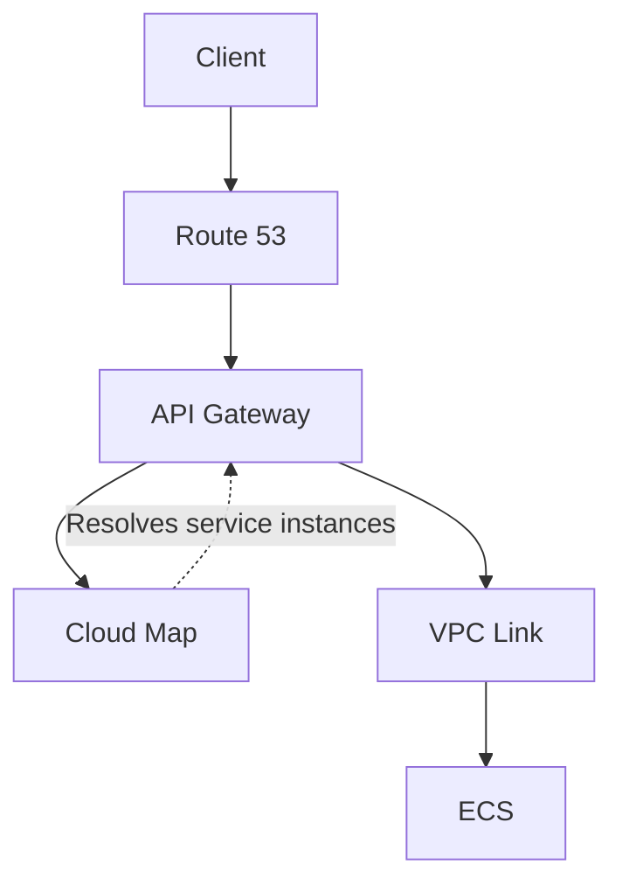

Sometime around April, I made a [post](https://www.reddit.com/r/aws/comments/1syh0gl/whats_your_cicd_flow_for_a_containerized_app_on/) on r/aws asking about the best way to deploy containers on AWS other than using ECS.

Why exclude ECS you might ask?

Well, it comes down to one of these things we humans call money. Or, if we want to make it sound more fun, the Benjamins.

At the time, I was working on a green field project and figured it was time to deploy it somewhere other than my MacBook.

I’d been using AWS for a couple of years. I wasn’t exactly a noob, but I definitely wouldn’t call myself an expert either. So I was genuinely curious the most cheapest way one could host a HTTP server that could scale.

I personally took it up as a challenge.

I’d used ECS before, and it’s probably the most straightforward AWS service for running containers.

You build your OCI image, push to a registry, and tell ECS to start a new deployment. From there, ECS handles the rest: it deploys your new image based on your configured strategy (rolling or blue-green), rolls back if something goes wrong, and gives you full visibility into every point from the dashboard.

Pretty classic if you're coming from the world of Kubernetes.

But unfortunately, the cloud bill for is a bit expensive for a solo project with zero users.

"But ECS the service itself is free," I hear you say

And yeah, you’re right. But the catch is that you still need some way to get incoming HTTP requests to your containers. And that usually means adding a front-facing gateway to proxy requests to them.

Hence, Application Load Balancer enters the chat, which alone costs you about $19/month regardless if it's idle or not.

Now think about that for a second... That's is the baseline cost before you've even touched other services. And if you have multiple long-lived environments, multiple that by how many you have as it's not really a resource you want to share across environment.

It's not looking good, is it?

Surprisingly, I got an influx of replies on the reddit post I made earlier. I got advice from using packer to bake an AMI and running on EC2, AppRunner (though now deprecated), webhooks with Komodo (which tbh, i don't even know what that is) and ECS.

Yes, you heard me right, ECS. After a long write up of how I specifically wanted it excluded due to it's cost 🙂.

But at a second look, the [comment](https://www.reddit.com/r/aws/comments/1syh0gl/comment/oiuog65/?utm_source=share&utm_medium=web3x&utm_name=web3xcss&utm_term=1&utm_content=share_button) caught my attention and planted a thought into my brain.

> FYI I used ECS (no cost) and run my own EC2 (paid) instances using bottlerocket os. No LB.

"No ALB? Could that really be viable?"

To cut the long story short, the answer is YES! After some research, I discovered the dated AWS blog post where [private integrations with AWS Cloud Map](https://aws.amazon.com/about-aws/whats-new/2020/03/api-gateway-private-integrations-aws-elb-cloudmap-http-apis-release/) was announced for API Gateway.

The release of this integration meant we could effectively swap API Gateway in place of an ALB as our public-facing entry point.

If you're lost and don't see how it fits together, let me break it down.

So API Gateway is a serverless router that handles incoming requests and forwards them to a destination. These destinations are what AWS calls "integrations".

They're basically a routing rule that answers "where do I send this incoming request to"

There are a few types:

1. AWS service integrations, such as a destination like an SQS queue, SNS topic, EventBridge and friends.
1. HTTP integration, which send requests to a public URL.
1. Or for our use case, private integrations, such as [Cloud Map](https://docs.aws.amazon.com/cloud-map/latest/dg/what-is-cloud-map.html)

We'll get to explain Cloud Map in a bit.

The main catch for us is API Gateway is pay-per-request and it's dirt cheap. We're talking $1 per million requests, with no baseline hourly cost compared to an ALB.

This makes it a godsend for applications with low traffic.

At the time before this integration existed, there's was no way for API Gateway to resolve URL addresses of resources within in a VPC so it wasn't considered an option.

That changed with the Cloud Map integration.

Here's what the full request chain looks like:

Cloud Map handles the heavy lifting of service discovery for us. You can picture it as a phonebook where an entity is assigned entry.

Ask yourself: how does Service A reliably find Service B when Service B's location is constantly changing?

Instead of relying on a hardcoded list of IP addresses that gets stale over time, Cloud Map lets services register and deregister themselves so other services can discover them.

For ECS, that means when a task gets launched, it registers it's reachable IP address and port into Cloud Map automatically.

With that in place, API Gateway can now lookup the address of registered tasks and forward requests to them.

But knowing where a task is doesn’t automatically make it reachable.

API Gateway is a managed service outside our VPC, hence we need one more component to complete the connection.

VPC link.

That’s the request path for this setup if we’re replacing the ALB with API Gateway.

Now, let's compare costs:



- Component
- Old
- New

---

- ALB
- ~$19/month base +&nbsp;$0.008 per LCU
- —

---

- API Gateway
- —
- ~$1/million requests

---

- Cloud Map
- —
- $0.10/per resource

---

- VPC link
- —
- $0

---

- **Total**
- **\~$19+/month before traffic**
- **Near zero**
  

The old setup had a baseline cost just for existing. Whereas this new setup, we pay for only what we use, which is pretty neat.

Now, if i'm to be fair and play devil's advocate, there's a lot of reasons to eat the cost and pay for an ALB. You lose out on some of its features such weighted target groups, gRPC support, OIDC and login flow.

You also need to consider API Gateway’s 10MB payload limit and how it selects Cloud Map targets. There's no round-bin as it randomly targets, compared to ALB which gives you target distribution controls.

If you desire any of the above features, then yeah, picking an ALB is no brainer. But if not, API Gateway can be a decent way to cut your cloud bill.

Your manager stays happy. Accounting definitely stays happy.

> [!NOTE]
> While the [AWS walkthrough tutorial](https://docs.aws.amazon.com/apigateway/latest/developerguide/http-api-develop-integrations-private.html) that depicts using SRV record for Cloud Map integration, it seems it isn't actually necessary.
>
> I asked AI at the time of writing and it responded API Gateway calls&nbsp;`DiscoverInstances` API instead of doing DNS lookups. So, in theory, you might not need a DNS Cloud Map namespace.
>
> Now, I haven't tested this myself, but you can verify yourself if you must use an API only namespace.

## Further cost optimization

I wasn't done yet. I asked myself: Can we make this even cheaper?

Frankly, the answer is almost always yes.

For most people new to ECS and with a bursty workload, your first choice for compute platform is Fargate. And that's fairly reasonable considering you don't have to create or manage servers yourself.

You specify the vCPU and memory for each task and AWS runs it for you, while handling OS patching and all.

At the end of the billing cycle, you pay for the vCPU and memory your tasks used for the time they were running.

Pretty straightforward.

But if you have a service with a steady baseline threshold, Fargate might not be the cheapest way to do it.

Punching into AWS calculator, running the bare minimum of 0.25 vCPU (which is complete buns btw) with 0.5 GB memory for a month straight will cost you ~$10

Oof. That's a huge no bueno for such little compute.

That’s what led me to [ECS on EC2](https://docs.aws.amazon.com/AmazonECS/latest/developerguide/create-capacity.html).

We create and register the underlying EC2 instances for the ECS cluster to use.

Anon from earlier reddit post pointed it out.

At the prices I was comparing, the same amount of money would get us a `t4g.micro` instance with 2 vCPU and 1GiB of memory for a fraction of the cost. And that's double the memory and 4x the cpu.

The major downside is that we’re now responsible for the instances. That means keeping them updated to stay secure.

If you must, adding ASG as a capacity provider will make your life easier. And can opt for an immutable AMI like [Bottlerocket](https://bottlerocket.dev/en/) to harden security.

It's built specifically for [running containers](https://docs.aws.amazon.com/AmazonECS/latest/developerguide/ecs-bottlerocket.html) and comes with good defaults, like SSH access being disabled OOTB.

Though, it's not without it's quirks so weigh the trade-offs before jumping the gun. The biggest is ECS Service Connect [isn't supported](https://github.com/bottlerocket-os/bottlerocket/issues/2801) at the moment.

And that's is all I have for today.

Hope this helps anyone running on super thin budgets.
